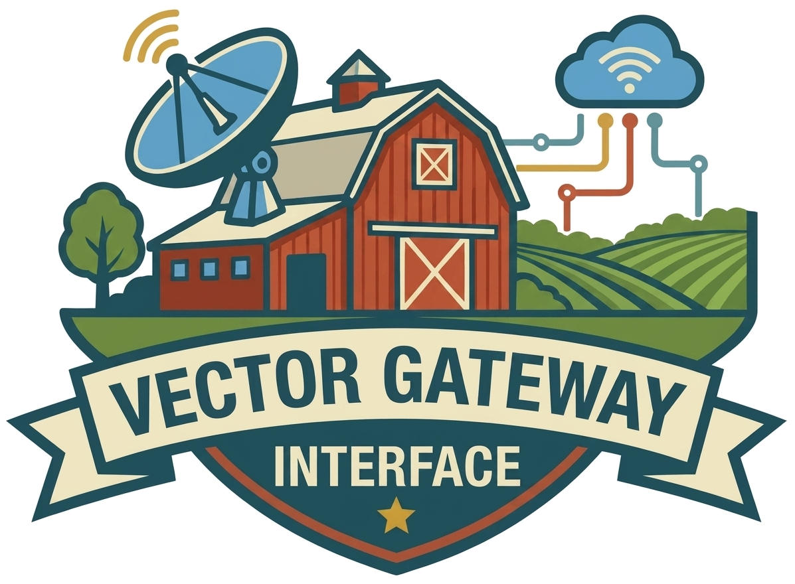

<p align="center">
  <a href="https://query.farm/vgi/">
    
  </a>
</p>

<h1 align="center">vgi-anthropic</h1>

<p align="center">
  Your <a href="https://www.anthropic.com">Anthropic</a> organization as ordinary DuckDB tables — members,<br>
  workspaces, API keys, rate limits, token usage, cost and Claude Code analytics.<br>
  A <strong>read-only</strong> <a href="https://query.farm/vgi/">VGI</a> worker, built by <a href="https://query.farm">🚜 Query.Farm</a>
</p>

<p align="center">
  <a href="https://github.com/Query-farm/vgi-anthropic/actions/workflows/ci.yml"></a>
  <a href="LICENSE"></a>
  
  <a href="https://query.farm/vgi/"></a>
</p>

---

> **Read-only, and no model calls.** This worker reads the
> [Admin API](https://platform.claude.com/docs/en/manage-claude/admin-api), the
> [Usage & Cost API](https://platform.claude.com/docs/en/manage-claude/usage-cost-api)
> and the Claude Code Analytics API. It never sends a message to a model, and it
> cannot invite, remove or re-role members, archive workspaces or disable keys —
> though an Admin key would allow all of that. Read-only is enforced structurally
> (one `_get` chokepoint in `anthropic_api.py`, the only module that so much as
> imports `httpx`) and by a CI guard (`tests/test_readonly_guard.py`). IDs that
> reach a URL path are percent-encoded, so a value from user SQL cannot traverse
> into a different resource.

```sql
CREATE SECRET anthropic (TYPE anthropic_admin, api_key 'sk-ant-admin01-...');
ATTACH 'anthropic' (TYPE vgi, LOCATION 'uv run anthropic_worker.py');

-- Who is spending what, this month?
SELECT COALESCE(w.name, 'Default') AS workspace, c.model, sum(c.amount_usd) AS usd
FROM anthropic.cost_report(date_trunc('month', current_date)) c
LEFT JOIN anthropic.workspaces w ON w.id = c.workspace_id
GROUP BY ALL ORDER BY usd DESC;
```

## Run

```bash
uv run anthropic_worker.py         # stdio
uv run serve.py --port 8000        # HTTP
```

```sql
ATTACH 'anthropic' (TYPE vgi, LOCATION 'uv run anthropic_worker.py');
```

Both scripts carry PEP-723 headers pinning their dependencies, so they run from
a fresh clone with nothing installed. That `LOCATION` resolves
`anthropic_worker.py` against the working directory, so it only works from
inside the clone. Anywhere else, point it at the repository and let `uvx` fetch
and cache the worker:

```sql
ATTACH 'anthropic' (TYPE vgi,
  LOCATION 'uvx --from git+https://github.com/Query-farm/vgi-anthropic vgi-anthropic');
```

Pin a tag for a deployment, so the worker cannot change under you:

```sql
ATTACH 'anthropic' (TYPE vgi,
  LOCATION 'uvx --from git+https://github.com/Query-farm/vgi-anthropic@v0.1.0 vgi-anthropic');
```

To run it as a server and attach to a URL instead, use the `vgi-anthropic-http`
entry point:

```sql
ATTACH 'anthropic' (TYPE vgi, LOCATION 'http://localhost:8000');
```

### Developing

```bash
git clone https://github.com/Query-farm/vgi-anthropic
cd vgi-anthropic

uv sync --all-extras     # Install dependencies
uv run pytest            # offline tests, including end-to-end SQL against a local fake API
uv run ruff check .      # Lint
```

## Credentials

Every object in the catalog needs an **Admin API key** (`sk-ant-admin01-...`),
which only an organization admin can create, in the Claude Console under
*Settings → Admin keys*. An organization-scoped personal or service-account key
works too, with the permissions of the account it belongs to, as does an
`org:admin` OAuth access token:

```sql
CREATE SECRET anthropic (TYPE anthropic_admin, api_key 'sk-ant-admin01-...');
-- or
CREATE SECRET anthropic (TYPE anthropic_admin, oauth_token '...');
```

- **It is a secret, never an ATTACH option.** ATTACH option strings are visible
  in `duckdb_databases()` and in anything that logs the statement; secret values
  are marked redacted, so `duckdb_secrets()` shows them masked.
- **Any name works**, or none. Secrets are selected by type, not name.
- **`SCOPE` chooses by endpoint.** When several `anthropic_admin` secrets exist,
  the one whose `SCOPE` is the longest prefix of the API base URL wins, and an
  unscoped one is the fallback — so a key for a gateway and a key for the API
  directly can coexist. (Two organizations behind the *same* URL need separate
  DuckDB sessions.)
- **Organization-scoped keys work; workspace-scoped keys do not.** Besides
  Admin keys, the API accepts an organization-scoped personal or
  service-account key, which carries the ordinary `sk-ant-api03-` prefix, so
  the worker never judges a key by its prefix. A *workspace*-scoped key can
  read `organization` and gets a 401 everywhere else (checked against the real
  API); the error names all three credentials that would work.
- **No environment-variable fallback, on purpose.** The same worker can be
  served over HTTP, and a key read from the server's environment would answer
  for every client that connects to it.

`VGI_ANTHROPIC_BASE_URL` overrides the API base URL (for a gateway, or the
tests' fake). It is deliberately *not* `ANTHROPIC_BASE_URL`, which SDKs and
Claude Code commonly point at a proxy — inheriting it would send an Admin key
wherever that happened to point.

## Surface

Names are bare — they are already qualified by the `anthropic` catalog.

### Tables: the organization as it is now

| Table | Rows | Notes |
|---|---|---|
| `organization` | 1 | The organization the credential belongs to |
| `users` | one per member | `WHERE email = …` is one API request |
| `invites` | one per invite | pending, accepted and expired |
| `workspaces` | one per workspace | **archived included** (`is_archived`); the default workspace is not listed |
| `workspace_members` | one per (workspace, member) | one request per active workspace; `WHERE workspace_id = …` reads one |
| `api_keys` | one per key | never the secret; `workspace_id` from `scope`, so it is real even for the default workspace; `status`/`workspace_id` filters are one request |
| `rate_limits` | one per (group, limiter) | `list_contains(models, 'claude-…')` finds a model's limits |
| `workspace_rate_limits` | one per (workspace, group, limiter) | inherited values included; `source` marks overrides |

Each table is backed by an `all_<table>()` scan function that VGI wires up
automatically. The function and table cannot share a name in one schema, so the
scan takes the `all_` prefix and the table keeps the name you type.

### Functions: history, keyed by a start time

| Function | Required | Named |
|---|---|---|
| `messages_usage(starting_at)` | start | `ending_at`, `bucket_width` (`1d`/`1h`/`1m`), `group_by`, `cache_ttl` |
| `cost_report(starting_at)` | start | `ending_at`, `group_by`, `cache_ttl` |
| `claude_code_usage(starting_date)` | first day | `ending_date` (inclusive), `cache_ttl` |
| `user_by_id(user_id)` | ID | — |
| `workspace_by_id(workspace_id)` | ID | — |
| `api_key_by_id(api_key_id)` | ID | — |

Times accept a string, a `DATE` or a `TIMESTAMP`. Strings and dates are read as
UTC, so `messages_usage('2026-09-01')`, `messages_usage(DATE '2026-09-01')` and
`messages_usage(current_date - INTERVAL 7 DAY)` all work. (A strictly typed
`TIMESTAMPTZ` argument would reject the bare string — DuckDB does not cast a
literal into a table function's typed argument — so the worker accepts all
three and parses them itself.)

The reports are **paged scans**: one API page per tick, so `LIMIT` stops the
walk early. The lookups are **blended**, so they compose as the inner side of a
correlated `LATERAL`:

```sql
SELECT k.name, u.email
FROM anthropic.api_keys k
LEFT JOIN LATERAL anthropic.user_by_id(k.created_by_id) u ON true;
```

An unknown ID — a member who has since left — yields no row rather than failing
the query.

## Design notes

### Report grouping follows your query

The usage and cost endpoints aggregate over every dimension they are not grouped
by, and report it as NULL. Taken literally, `SELECT model, sum(output_tokens)
FROM messages_usage(...) GROUP BY model` would return one row with a NULL model —
plausible-looking and useless.

So when `group_by` is not given, the report groups by exactly the dimension
columns the query references. DuckDB tells the scan which columns it projected,
and a column used in `WHERE` is always among them:

```sql
-- No dimensions referenced: one total per day.
SELECT bucket_start, sum(output_tokens) FROM anthropic.messages_usage('2026-09-01') GROUP BY 1;

-- `model` referenced: grouped by model, no argument needed.
SELECT model, sum(output_tokens) FROM anthropic.messages_usage('2026-09-01') GROUP BY 1;

-- `WHERE` pins a dimension: sent upstream as the API's own filter, and grouped.
SELECT sum(output_tokens) FROM anthropic.messages_usage('2026-09-01') WHERE model = 'claude-opus-5-5';
```

Totals are the same whichever way it groups; only the breakdown changes. An
explicit `group_by => [...]` is honoured, plus any dimension the `WHERE` pins with
`=` (grouping by a single-valued dimension adds no rows). `speed` is never
inferred, because grouping by it needs a beta header; ask for it by name.

For `cost_report`, selecting `workspace_id` groups by workspace, and selecting
`description` *or any column it populates* — `model`, `token_type`, `cost_type`,
`service_tier`, `context_window`, `inference_geo` — groups by description.

### Money is DECIMAL, never DOUBLE

The cost report sends amounts as decimal strings in **cents**. `amount_cents`
carries that exactly and `amount_usd` divides by 100 exactly, both as `DECIMAL`.
A float would lose sub-cent precision silently, and sums would stop reconciling
with the invoice. Priority Tier spend is not in the cost endpoint — Anthropic
bills it differently — so use `messages_usage` with `service_tier` for it.

### The default workspace

It is not in `workspaces`, and usage and cost attribute it to a **NULL**
`workspace_id`. Use a `LEFT JOIN` and `COALESCE(w.name, 'Default')`. (API keys are
the exception: their `workspace_id` comes from `scope`, which carries the default
workspace's real ID.)

### Pushdown is conservative

Declaring filter pushdown makes DuckDB drop its own filter above the scan, so
the worker applies every pushed predicate itself. A predicate becomes an API
parameter only when the API's meaning is the same as the SQL's, or broader. The users
`email` filter is case-insensitive, which is broader, so it is pushed and the
exact `=` is re-applied. `api_keys.workspace_id` is pushed because the API filters
on the key's `scope`, which is exactly what the column holds. `api_keys.created_by_id` is pushed as the API's
`created_by_user_id` only for `user_…` IDs: pushing a service account's ID into
a *user* filter would drop the very rows the predicate matches.

### Retries

Every request is a `GET`, so every transient failure is retried with exponential
backoff: 429, Anthropic's 529 overload, gateway 5xx and transport errors. A
`retry-after` header is honoured (capped at 30s), and so is `x-should-retry`,
which the API sends on errors to say whether another attempt can help — it
overrides the status in both directions, as it does in Anthropic's SDKs. The Usage API documents
sustained polling at once a minute; `cache_ttl => N` on the reports caches a
result for dashboards that refresh more often. Usage usually appears within five
minutes of a request completing, so a cached report of the last few minutes can
be short.

### Not exposed

- **The Messages API** — this worker reports on model use, it does not make any.
- **Every Admin API write.**
- **Service accounts and federation** — those endpoints accept only an
  `org:admin` OAuth token, not an Admin key.
- **Claude Platform on AWS** exposes only the workspace endpoints; elsewhere the
  worker reports the 403 with that explanation.

## Catalog metadata

Everything a client sees on `ATTACH` — descriptions, column comments, result
schemas, examples, categories — is published as `vgi.*` tags and checked by
[vgi-lint](https://github.com/Query-farm/vgi-lint-check):

```bash
vgi-lint lint --audit-waivers     # config lives in vgi-lint.toml
```

Column documentation has a single source: `vgi_anthropic/schemas.py` attaches a
comment to every Arrow field, and the same strings build each function's declared
result schema, so `DESCRIBE`, `duckdb_columns()` and `vgi.result_columns_schema`
cannot drift apart.

The agent-suitability suite is split in two. The public prompts are the
`vgi.agent_test_tasks` tag; the graders (reference SQL, success criteria) live in
`vgi-agent-tests.yaml`, outside the catalog, so an analyst under test cannot read
the answers from the metadata it is graded on. `tests/test_catalog.py` keeps the
two in step and checks that every object is exercised by some task.

One rule is waived: VGI311 asks that a parameterless scan be exposed as a table,
which all eight are — the rule matches on name, and the names differ by design.

## Tests

```bash
uv run pytest                    # offline: unit, SDK conformance, end-to-end SQL (stdio and HTTP)
uv run pytest -m live            # against the real API; each test runs only if its key is set
scripts/lint-behavioural.sh      # vgi-lint executing every shipped example against the fake API
```

| Live suite | Key | What it checks |
|---|---|---|
| `tests/test_live.py` | `ANTHROPIC_ADMIN_API_KEY` | real data through every table and report; skips, saying why, if the key lacks admin access |
| `tests/test_live_errors.py` | `ANTHROPIC_WORKSPACE_KEY`, `ANTHROPIC_NON_ADMIN_KEY` (and none, for the invalid-key case) | each real refusal (401 wrong key scope, 403 not an admin, 401 invalid) reaches the user with the API's message, the worker's explanation, and the request ID when the API sent one — and a lookup raises on a 403 instead of answering "no row" |

`tests/test_end_to_end.py` is the suite that matters most. It runs the real stack
— Haybarn's DuckDB, the vgi extension, the worker as a subprocess — against
`tests/fake_admin_api.py`, a local fake that implements both paging styles,
`group_by[]` aggregation, the documented filters and 404s, and records every
request. Tests assert on the rows *and* on what went upstream: that `WHERE
workspace_id = …` costs one request, that a `LIMIT` stops a walk, that no
pushed filter drops a matching row. Argument casting, projection and pushdown are
performed by the extension, so nothing short of a real `ATTACH` exercises them —
both bugs this suite was written against were invisible to unit tests.

`tests/test_sdk_conformance.py` validates every admin object the fake serves
against Anthropic's own Python SDK models, in both directions: no field the SDK
does not know, none it declares missing. The SDK has no models for the usage,
cost and Claude Code reports, so those shapes rest on the documentation alone.
`tests/test_http_serving.py` runs the worker behind `serve.py` with two clients
and checks each is authorized only by its own secret.

The live data suite reads only what every organization has (one row in
`organization`, at least one admin), so it passes against an organization that
has never sent a request. It reads the key from the environment and hands it to
DuckDB as a secret, exactly as a user would; the worker itself never reads the
environment for credentials.

## CI

`.github/workflows/ci.yml` runs on every push: ruff (lint and format), the full
offline suite including end-to-end SQL (no key or network needed), a check that
both entry points start from their PEP-723 headers alone, and `vgi-lint`'s
structural tier at `--fail-on warning` — then its behavioural tier against the
fake API, executing every shipped example and comparing every declared result.

Declared results are compared only when they sit on a *statement*
(`"sql": [{"sql": …, "expected_result": …}]`). Put at the top level of an
example, vgi-lint 0.82 accepts them and silently never checks them; a
deliberately wrong expectation passed until they were moved.

`.github/workflows/live.yml` runs daily or by hand, never on a pull request,
with the `ANTHROPIC_ADMIN_API_KEY` repository secret — a fork's pull request
could otherwise read a real organization's members, keys and spend.

## License

Copyright © 2026 [Query Farm LLC](https://query.farm)

Released under the **MIT License** — see [LICENSE](LICENSE). Organization data
read through this worker belongs to the organization; see [NOTICE](NOTICE).
